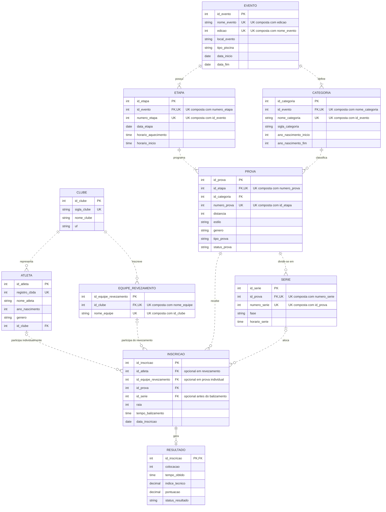

# Questão 1 — Modelagem de Dados com Mermaid

## 1. Análise da página oficial

A página oficial fornecida para o **29º Troféu Alexandre Pussieldi Pré/Mirim**, no portal da Federação Aquática do Estado de Alagoas, apresenta as provas da competição e permite expandir seus resultados. O evento ocorreu de **27 a 29 de março de 2025**, na **UFAL, em Maceió/AL**.

Na página foram observados:

- 59 provas, das quais uma já estava expandida e outras 58 possuíam o botão de resultados, identificadas por distância, estilo e gênero, como `50M LIVRE FEM.` e `100M BORBOLETA MASC.`;
- categorias ou classes como `PRÉ-MIRIM`, `MIRIM 1` e `MIRIM 2`;
- status da prova, como `FINAL` e `CONCLUÍDA`;
- quantidade de atletas e de séries;
- identificação da fase e da série, como `FINAL` e `SÉRIE 1`;
- colunas de resultado: colocação, raia, atleta, entidade, nascimento, índice técnico, tempo, tempo de balizamento e pontos;
- exemplo exibido: atleta Julia Gomes Ribeiro, entidade Vila Parahyba, nascimento em 2016, índice técnico 66, tempo `2:13.58`, balizamento `2:17.48` e 25 pontos;
- 24 entidades distintas nos resultados coletados e anos de nascimento entre 2015 e 2018 para provas individuais;
- colocações numéricas e ocorrências especiais como `DQL` e `N/C`;
- provas individuais e revezamentos. Nos revezamentos, a coluna `ATLETA` apresenta equipes como `AABB RECIFE A`, com nascimento técnico `1800`, evidenciando que a equipe não deve ser modelada como pessoa.

O portal usa a palavra **entidade** para a equipe representada pelo atleta. No modelo, foi adotado o nome `CLUBE`, mais específico para o domínio da natação e compatível com o enunciado.

Fonte analisada: [página de provas do 29º Troféu Alexandre Pussieldi Pré-Mirim no portal FAEAL](https://faeal.com.br/evento/natacao/v1_TQDY9HjWGRflRKrrYIIALu9CWL0CC26AxEuMGAtyf4o.0-S4MyRXqT-EAGrQfGcZcZr85NJsuUAUkN57FGjB9NI/29-trofeu-alexandre-pussieldi-pre-mirim?tab=provas), fornecida junto à atividade.

## 2. Entidades e atributos

| Entidade | Principais atributos | Chaves |
|---|---|---|
| `EVENTO` | nome, edição, local, piscina, início e fim | PK `id_evento`; UK `(nome_evento, edicao)` |
| `ETAPA` | número, data, aquecimento e início | PK `id_etapa`; FK `id_evento`; UK `(id_evento, numero_etapa)` |
| `CLUBE` | sigla, nome e UF | PK `id_clube`; UK `sigla_clube` |
| `CATEGORIA` | nome, sigla e intervalo de anos de nascimento | PK `id_categoria`; FK `id_evento`; UK `(id_evento, nome_categoria)` |
| `ATLETA` | registro CBDA, nome, nascimento e gênero | PK `id_atleta`; FK `id_clube`; UK `registro_cbda` |
| `EQUIPE_REVEZAMENTO` | nome da equipe de revezamento | PK `id_equipe_revezamento`; FK `id_clube`; UK `(id_clube, nome_equipe)` |
| `PROVA` | número, distância, estilo, gênero, tipo e status | PK `id_prova`; FKs `id_etapa` e `id_categoria`; UK `(id_etapa, numero_prova)` |
| `SERIE` | número, fase e horário | PK `id_serie`; FK `id_prova`; UK `(id_prova, numero_serie)` |
| `INSCRICAO` | participante, série, raia, balizamento e data | PK `id_inscricao`; FKs opcionais `id_atleta` e `id_equipe_revezamento`; FKs `id_prova` e `id_serie` |
| `RESULTADO` | colocação, tempo, índice técnico, pontos e status | `id_inscricao` é simultaneamente PK e FK |

`INSCRICAO` é a entidade associativa entre participante e prova. Em uma prova individual, ela referencia um atleta; em um revezamento, referencia uma equipe. Uma restrição de exclusividade (XOR) exige exatamente um desses participantes. A série é opcional enquanto o balizamento ainda não foi definido. O resultado também é opcional porque uma inscrição pode existir antes da realização da prova.

## 3. Relacionamentos e cardinalidades

| Relacionamento | Cardinalidade | Justificativa |
|---|---|---|
| `EVENTO` — `ETAPA` | 1 : 1..N | Um evento possui uma ou mais etapas; cada etapa pertence a exatamente um evento. |
| `EVENTO` — `CATEGORIA` | 1 : 1..N | Uma edição define suas categorias e anos de nascimento; cada categoria pertence a um evento. |
| `ETAPA` — `PROVA` | 1 : 1..N | Uma etapa programa uma ou mais provas; cada prova pertence a uma etapa. |
| `CATEGORIA` — `PROVA` | 1 : 0..N | Uma categoria pode classificar várias provas; cada prova possui uma categoria. |
| `CLUBE` — `ATLETA` | 1 : 0..N | Um clube pode possuir vários atletas; cada atleta representa um clube no evento. |
| `CLUBE` — `EQUIPE_REVEZAMENTO` | 1 : 0..N | Um clube pode inscrever várias equipes de revezamento; cada equipe representa um clube. |
| `PROVA` — `SERIE` | 1 : 0..N | A página mostra provas sem séries e provas com uma ou mais séries. |
| `ATLETA` — `INSCRICAO` | 0..1 : 0..N | Uma inscrição individual referencia um atleta; inscrições de revezamento não o referenciam diretamente. |
| `EQUIPE_REVEZAMENTO` — `INSCRICAO` | 0..1 : 0..N | Uma inscrição de revezamento referencia uma equipe; inscrições individuais não a referenciam. |
| `PROVA` — `INSCRICAO` | 1 : 0..N | Uma prova pode não ter atletas ou receber várias inscrições. |
| `SERIE` — `INSCRICAO` | 0..1 : 0..N | Uma inscrição pode aguardar balizamento ou pertencer a uma série; cada série agrupa várias inscrições. |
| `INSCRICAO` — `RESULTADO` | 1 : 0..1 | Uma inscrição pode ainda não ter resultado e pode gerar no máximo um. |

Os relacionamentos são não identificadores e aparecem com linha tracejada (`..`) quando a entidade filha possui uma PK própria. `INSCRICAO`—`RESULTADO` usa linha sólida (`--`) porque `RESULTADO.id_inscricao` é PK e FK, fazendo o resultado depender da identidade da inscrição.

## 4. Diagrama Mermaid

O mesmo código está isolado no arquivo [`modelo-er.mmd`](modelo-er.mmd) para ser colado no Mermaid Live Editor.

## 5. Decisões de modelagem

- `CATEGORIA` pertence ao evento e é associada à prova. O portal usa as classes `PRÉ-MIRIM`, `MIRIM 1` e `MIRIM 2` junto aos anos de nascimento; por isso, a categoria não é um atributo permanente do atleta.
- `SERIE` foi incluída porque a página informa quantidade de séries e apresenta resultados separados por série.
- `EQUIPE_REVEZAMENTO` foi separada de `ATLETA`: o site exibe nomes de equipes e o valor técnico `1800` na coluna de nascimento para revezamentos. A inscrição usa uma regra XOR: atleta ou equipe, nunca ambos.
- `raia` e `tempo_balizamento` foram colocados em `INSCRICAO`, pois são definidos antes do resultado.
- O valor `99:99.99` exibido quando não existe tempo de balizamento deve ser normalizado como ausência de valor, e não armazenado como um horário válido.
- `indice_tecnico`, `tempo_obtido` e `pontuacao` pertencem a `RESULTADO`, conforme as colunas exibidas no portal.
- `status_prova` pertence a `PROVA`, pois a página indica situações como `FINAL` e `CONCLUÍDA` para cada prova.
